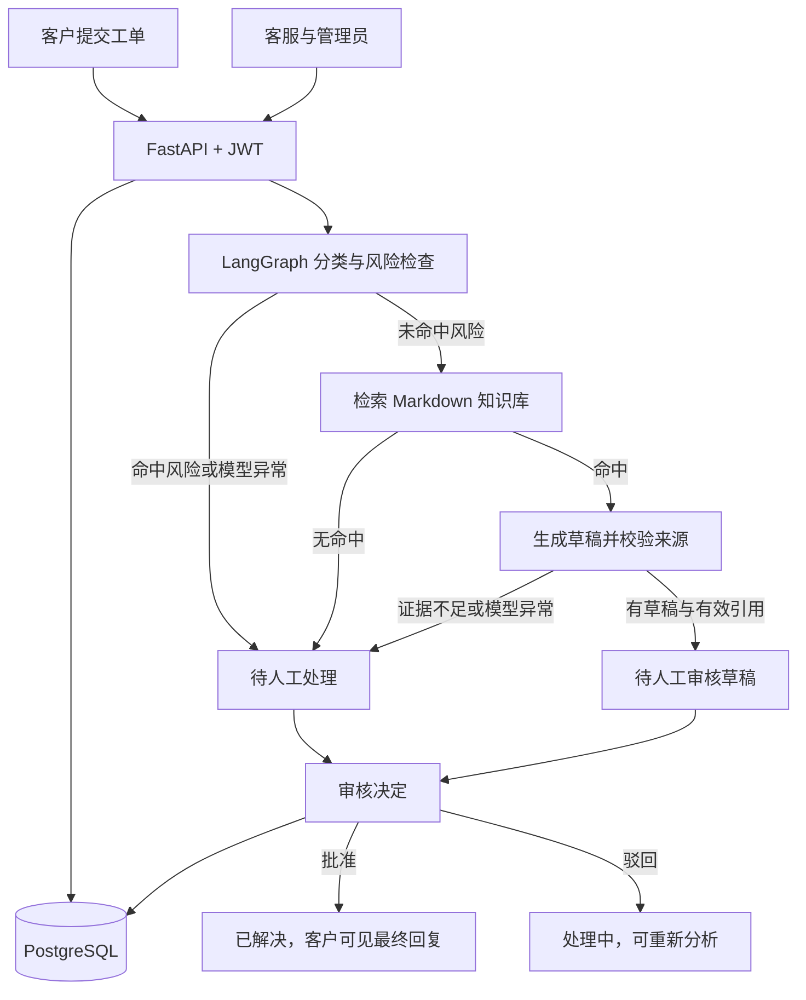

# AI Support Agent 架构

## 权限和数据边界

| 身份 | 工单访问 | 操作 |
| --- | --- | --- |
| 客户 | 仅本人工单、状态与最终回复 | 创建、编辑及删除待处理工单 |
| 客服 | 所有未删除工单、分析、来源、历史审核与日志 | 客户操作之外，还可更新状态、分析、批准和驳回 |
| 管理员 | 与客服相同 | 可授予或收回客服权限 |

用户主体来自模板 JWT，服务端查数据库得到有效角色。客户查询和变更同时限定工单所有者，非本人 ID 返回 404。分析、审核和状态更新要求客服或管理员。公开注册与自助用户更新均无法授予客服角色。工单的删除为软删除，日志留在数据库中。模板原有账号删除会级联删除该账号的工单和工单记录。审核人或操作者的账号删除时，引用置空。

## 状态与事务

- 初始为 `open`，工作人员可手动流转为 `in_progress → resolved → closed`，手动解决需要备注。
- `open` 或 `in_progress` 可运行分析并进入 `waiting_review`。有草稿和无草稿都需要审核。批准后入库最终回复并变为 `resolved`，驳回返回 `in_progress`。
- 修改需要工单版本。写入时使用 PostgreSQL 行锁并核对版本。模型调用前释放数据库事务，结束后再次核对权限和版本；并发调用可能各执行模型，只有当前版本可以提交。
- 每次分析将状态、分析、来源快照和日志放在同一事务。审核也将状态、决定和日志一起提交。每条分析最多一条审核记录，由主键约束保证。旧分析和旧审核在重新处理后仍可回看。

## 检索和模型

Markdown 切段后，英文分词与中文双字切分进入 BM25 排序。选取最多四个片段作为上下文。Mock 为确定性规则和摘录模板。DeepSeek 使用 OpenAI 兼容 Chat Completions JSON 模式，Pydantic 校验分类和优先级等字段。规则和模型风险标记取并集，命中后跳过草稿。缺少检索命中、模型不可用或引用超出本次候选集合时转人工。引用校验核对来源 ID，审核人核对内容是否受到引文支持。项目保存最终回复供客户在详情中查看。

## 文件入口

| 文件 | 职责 |
| --- | --- |
| `backend/app/api/routes/support.py` | 权限、状态流转、持久化 |
| `backend/app/support/{models,schemas}.py` | SQLModel 表与 Pydantic 契约 |
| `backend/app/support/{workflow,providers,knowledge}.py` | LangGraph、模型模式与检索 |
| `frontend/src/routes/_layout/tickets.tsx` | 工单工作台 |
| `backend/app/alembic/versions/4ee3ac912dc1_add_support_tickets.py` | 增量迁移 |

[官方模板提交](https://github.com/fastapi/full-stack-fastapi-template/tree/aabb90126964a164e02aff39e7c385bb0598236d) · [LangGraph Graph API](https://docs.langchain.com/oss/python/langgraph/graph-api) · [DeepSeek JSON Output](https://api-docs.deepseek.com/guides/json_mode/)

